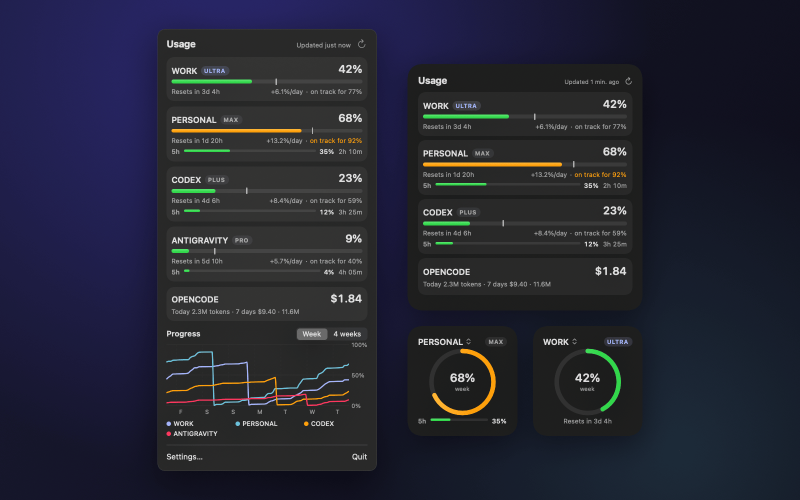
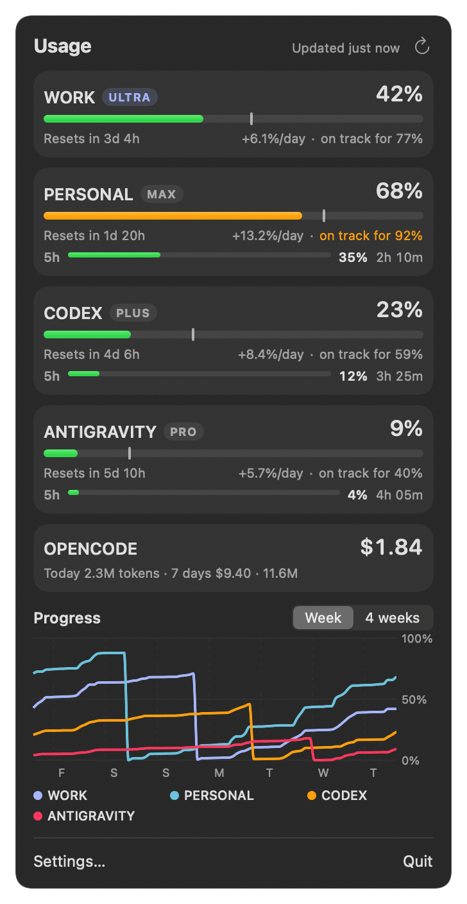
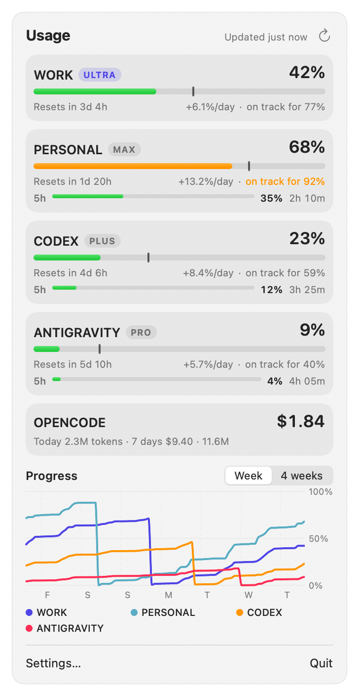
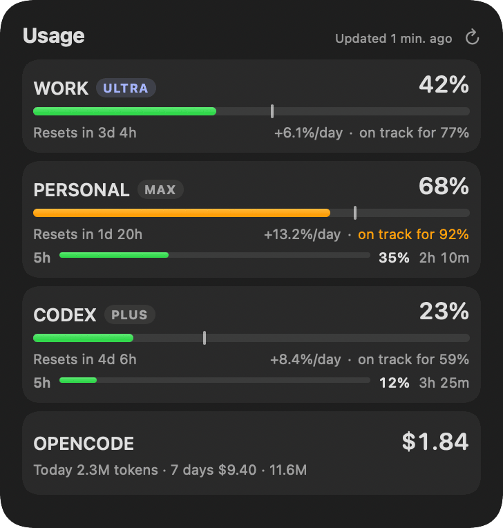
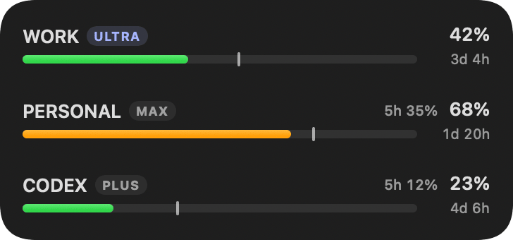
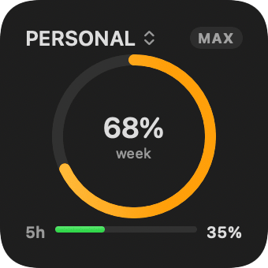
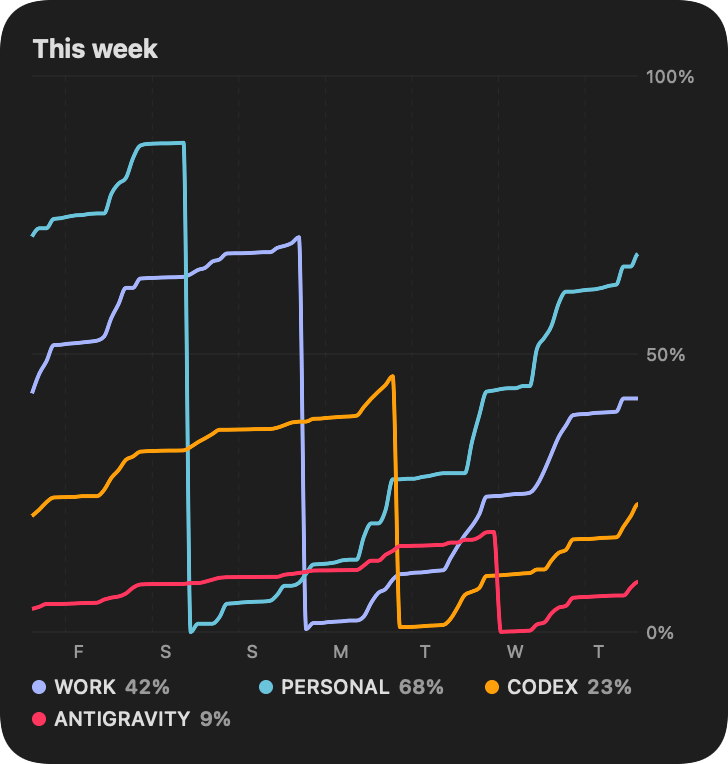

  

# Agents Usage Watch

**Your coding agents' plan limits, in the macOS menu bar and on your desktop.**

Agents Usage Watch shows how much of your 5-hour and weekly limits you've used in Claude Code, OpenAI Codex and
the Antigravity CLI, plus what opencode spent. Every login sits side by side, with reset countdowns, a pace
marker and a forecast of where the week will end. It reads files the agents already write on your Mac. It
doesn't log in anywhere, makes no network requests for your usage, and has no analytics.

Free and open source under the [MIT License](LICENSE). Made by [AgentsTrack](https://agentstrack.ai).
Requires macOS 14 Sonoma or later.

## Features

- **Menu bar:** your highest usage at a glance. The panel lists every account with its weekly bar, the 5-hour
  bar where the plan has one, a pace tick (where you'd be if you used the week evenly), the trend
  (`+3.9%/day`), a projection (`on track for 52%` / `runs out before reset`) and a chart of the week or the
  last 4 weeks.
- **Widgets:** *Usage* and *Usage Progress*, each in small, medium and large. Pick accounts, background and
  what to show per widget. The small ones have an account switcher. With many accounts the larger ones switch
  to denser rows so everyone stays visible.
- **Notifications:** thresholds for the 5-hour and weekly windows, forecasts ("may run out before reset"),
  a "burning much faster than usual" alert, quiet hours, a choice of sound, and a test button that tells you
  if macOS is blocking notifications.
- **Accounts:** found automatically. Rename, hide, reorder, and choose which ones appear in the menu bar and
  in widgets.

## Screenshots

<table>
  <tr>
    <td align="center"></td>
    <td align="center"></td>
  </tr>
  <tr>
    <td align="center" colspan="2"></td>
  </tr>
</table>
<table>
  <tr>
    <td align="center"></td>
    <td align="center"></td>
    <td align="center"></td>
  </tr>
</table>

## Supported agents

| Agent | What it shows | Where it comes from |
|---|---|---|
| **Claude Code** | 5-hour and weekly limits, plan | Claude Code's status line JSON (`rate_limits`), saved by a small helper after each message. Needs **Set Up** once per account. Works for `~/.claude` and every `CLAUDE_CONFIG_DIR` folder. |
| **OpenAI Codex CLI** | 5-hour and weekly limits, plan | The `rate_limits` Codex writes into its session logs (`~/.codex/sessions`). No setup. |
| **Antigravity CLI** (`agy`) | 5-hour and weekly limits for Gemini and for third-party models | The `quota` in agy's status line JSON, saved by a helper. Needs **Set Up**. |
| **opencode** | Tokens and cost today and over 7 days (no plan limit) | opencode's own SQLite database, opened read-only. No setup. |

Values are as fresh as the agent's last message. Details per agent are in [docs/agents.md](docs/agents.md).

## Download

1. Download [**Agents-Usage-Watch.zip**](https://github.com/agentstrack/agents-usage-watch/releases/latest/download/Agents-Usage-Watch.zip)
   and unzip it.
2. Move **Agents Usage Watch.app** to your Applications folder.
3. Open it. The first launch is blocked by Gatekeeper, because the app is signed with an Apple Development
   certificate but not notarized yet. Do one of these:
   - right-click the app › **Open**, then **Open** again; or
   - open **System Settings › Privacy & Security**, scroll down and click **Open Anyway**; or
   - run `xattr -dr com.apple.quarantine "/Applications/Agents Usage Watch.app"` in Terminal.

You only do this once. Prefer to build it yourself? See [docs/installation.md](docs/installation.md).

## Quick start

1. Open the app. A gauge appears in the menu bar. Click it to see your accounts.
2. For **Claude Code** and **Antigravity**, open **Settings › Accounts** and click **Set Up** next to the
   account. Codex and opencode need nothing.
3. Use the agent. Limits show up after its next message.
4. Add widgets: right-click the desktop › **Edit Widgets** › Agents Usage Watch.

Set Up points the agent's `statusLine` at a helper script and keeps your old status line working. It backs up
`settings.json` first, and **Remove** puts everything back.

## Privacy

- No network requests for your usage. The app reads the agents' own local files.
- No logins and no credentials used. For Codex it opens `~/.codex/auth.json` only to check that you're logged
  in and to show the account email.
- No analytics. Nothing about you or your usage leaves your Mac.
- The widget is sandboxed and only reads a snapshot the app writes.

The exact list of files read and written is in [docs/privacy.md](docs/privacy.md).

## Documentation

| | |
|---|---|
| [Installation](docs/installation.md) | Download, build from source, login item, uninstall |
| [Agents](docs/agents.md) | What each agent shows, where it comes from, setup, freshness |
| [Widgets](docs/widgets.md) | Sizes, account switcher, options, many accounts |
| [Notifications](docs/notifications.md) | Alert rules, quiet hours, sounds, Focus |
| [Troubleshooting](docs/troubleshooting.md) | Off-screen panel, missing alerts, empty widgets, Gatekeeper |
| [Privacy](docs/privacy.md) | Every file read and written |
| [Architecture](docs/architecture.md) | How it works, adding an agent, running the checks |

## Contributing

Bug reports, fixes and support for more agents are welcome. See [CONTRIBUTING.md](CONTRIBUTING.md). To report
a security problem, see [SECURITY.md](SECURITY.md).

## License

[MIT](LICENSE): free to use, change and share, including commercially.

Not affiliated with Anthropic, OpenAI, Google or the opencode project. Product names appear only to say which
tools are supported.
